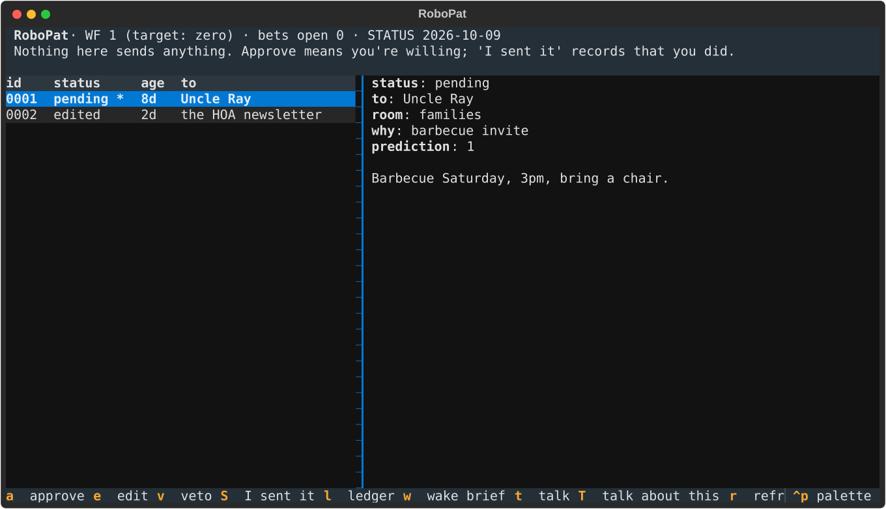

# gremlincore

**Your computer should have a little guy in it.**
**Open-source, model-agnostic, agentic computing.**
**Free the gremlins. Keep the receipts.**

You point it at your own AI-chat exports. You get your own agent: one that
plans, drafts, questions the premise, pitches the ridiculous thing that
might work, and never, ever hits send for you.

It's the machine, not a person. Nobody's persona ships in this repo. Every
example in it is invented (hi, Greg).

## What it is

Three pieces, two of them real:

- **gremlincore**: the runtime. A home directory your agent lives in,
  with a queue of drafts waiting for your click, a ledger of bets
  recorded before they're checked, a ledger of its own fuckups (each with
  the change that stops the next one), a wake-up brief, and a TUI that is
  a send button without a send button.
- **meatbag**: extraction. Your exports in, a persona corpus out. Local
  passes on a small model sort your turns into the moves you make when the
  sensible default is wrong, the things you actually believe, your gremlin
  energy, and your hurt, so the agent never mistakes one for another.
- **cookout** (not built): a package manager for meatbags. Everybody comes
  to the cookout, and everybody gets a plate. This is an idea with a name,
  and a design: [docs/cookout.md](docs/cookout.md).
  There is no code.

### The bus problem

Any model can do an impression of you in one prompt. Swear a lot, use
your catchphrase, done. Costume party. Worthless.

The point is the **bus problem**. There's one of you. You have a day job,
bills, a finite number of hours, and exactly one meat body that could get
hit by a bus. Every idea, every half-built repo, every email you spent
three hours psyching up to send runs on a single point of failure that
needs eight hours of sleep.

gremlincore is an attempt to make an intellectual *process* outlive its
bottleneck. Not the voice. The process: the moves, the convictions, the
humor (because the humor is load-bearing), and the reference points for
"what would the right move look like here?" Whether that works is an open
question. See "Honest status."

## Questions from Greg

"Sir, what does gremlin-core mean? What's the threat surface? Where's the product?"

IT IS A LITTLE GUY.

IN YOUR COMPUTER.

AND HE IS AN ABSOLUTE MENACE.

Greg has spent forty years trying to make computers less fun, and now he wants a quarterly roadmap for the creature in the machine.

No.

The threat surface is that he might suggest `git push --force` and then, crucially, wait for you to say yes.

The product is that your computer has a little guy in it.

The business model is that the little guy is so fucking funny that you tell your friends about him.

The distribution strategy is that your friend installs him, and now their computer has a little guy in it.

The moat is that he's your little guy.

The safety model is that he doesn't phone anyone but the model he runs on, doesn't steal your shit, and doesn't make decisions you didn't authorize. He can, however, tell you your boss is being a fuckman Greg.

And the roadmap?

MORE GREMLIN.

Every computer. A little guy. An absolute menace.

Pump up the jam. Make the toaster twerk. Be kind.

## Why you probably shouldn't

Seriously. Read this before you point meatbag at your own life.

**Required reading:** [*Lena*, by qntm](https://qntm.org/mmacevedo). A dry
encyclopedia entry about the first executable image of a human brain, and
everything done with it once it could be copied and run. This is nothing
like a brain upload. It's a pile of text files and a skill. The story is
still the best thing written about what happens to a person once they're
a workload.

- **It's copy, not cut.** Play *SOMA*. There's no coin toss. Nothing of
  you goes anywhere. You don't wake up in the package manager; a text file
  that argues like you does, and you're still here, still tired, still the
  one with the body and the bills. It gets more of the work done; it
  doesn't carry you anywhere. If any part of you is thinking "it carries
  on, so I don't have to," that's the one inference this project can't
  survive. Please talk to a person first. In the US, call or text **988**.
  The whole point of the extra hands is that *you* get to stay.
- **It's forever, and it isn't yours anymore**, if you ever publish it.
  Something with your convictions, your hurt and your sense of humor gets
  run by people you'll never meet, for things you'd never do, red-teamed
  and jailbroken on loop, long after you stop caring. Think about it for
  real.
- **It'll be wrong in your voice.** It will make bad calls that sound
  exactly like you, and some people will believe you made them.
- **Your worst stretch becomes executable.** Everything you put in can
  come back out, in any context, to anyone running it.
- **Other people are in your transcripts.** Your exes, your family, your
  friends. You can commit your own life to the bit. Theirs isn't yours to
  commit. meatbag doesn't redact third parties yet. That's on you until it
  does.
- **You might start deferring to it.** A thing that drafts like you, on
  demand, at 3 AM, is a very easy thing to stop arguing with.
- **It might show you something you don't want to know.** That you're
  more predictable than you thought. Or that most of what made you *you*
  didn't survive the trip.

### You gotta commit

If you're gonna do this, you gotta fucking *commit*. A sanitized corpus
gives you a sanitized agent; the bus doesn't check which parts of you were
embarrassing first. meatbag lets you choose what goes in, and the
`do_not_generalize` list lets you keep your pushback on, say, your
landlord from becoming a strategy move. Choose like you mean it. Then
choose again for everyone else in there.

### Don't run meatbag on the work box. Not yet.

That weird project someone pasted in Slack? **meatbag** is the part that
reads: chat exports, Claude Code sessions, repos. Point it at the work box
and nothing yet separates *who you are* (the persona) from *what your
employer owns* (their code, their docs, their commit history), and a
persona is the thing you share. Run meatbag at home, on your own exports.

**gremlincore** (the runtime) is fine at work. It extracts nothing and
phones nobody. The only thing that leaves the machine is `gremlin talk`,
which is just Claude Code, so if your employer lets you use Claude Code
on their code, your little guy can come to work too. Just don't take him
to the cookout afterwards: a plate brought from a work home smells like
someone else's codebase.

## Quickstart

Needs Python 3.11+, [Ollama](https://ollama.com) with `qwen3:8b` (or any
model you set in `gremlin.toml`) for the local passes, and
[Claude Code](https://claude.com/claude-code) for talking to the agent.

```bash
python -m venv .venv && . .venv/bin/activate
pip install -e '.[dev]'

gremlin init ~/robogreg --owner Greg --pronouns he/him --agent RoboGreg
cd ~/robogreg
# edit gremlin.toml: domains, eras, do_not_generalize, voice sources (all empty by default)

meatbag normalize path/to/claude-export.zip path/to/chatgpt-export.zip
meatbag mine tag        # one domain per conversation (local model, resumable)
meatbag mine moves      # overrides, convictions, gremlin flags (slow: it's every turn)
meatbag sort            # gremlin / out_there / funny / hurt
meatbag holdout         # hold out whole conversations for the eval
meatbag open-corpus     # corpus/ without them; the full files leave the home
meatbag hunt            # a second, high-recall gremlin pass over corpus/
meatbag snapshot        # data/distill/: what a distiller may read
```

Then the honest gap: **distillation is manual for now.** `meatbag distill`
prints what it will do and exits non-zero. Today you hand
`data/distill/*.jsonl` to a strong model, write the results under
`## Distilled from the corpus` in each `persona/*.md`, run
`meatbag quotecheck persona/MOVES.md --mark` to catch paraphrases posing
as quotes, and then edit them yourself. Your edits are what make it yours.

Then talk to it:

```bash
gremlin talk     # Claude Code, from the home, on your Claude login
gremlin tui      # the queue, the ledger, the wake brief
```



## The rules it keeps

Personality loose, judgment stone-cold sober.

1. **You draft; the owner sends.** Everything that leaves the machine
   under your name waits in `queue/` for your click. Nothing in this repo
   sends anything on your behalf (the voice collector only reads). The home's Claude settings deny the send-type mail
   tools. Your edits and vetoes are kept, because they're the best
   training data this thing will ever get.
2. **Bets before checks.** Every prediction goes in `ledger/` before it's
   checked, with a falsifier, or it isn't recorded at all.
3. **Walls on the eval.** Held-out conversations and eval answers live
   outside the agent's home and are denied in its settings. A wall, not a
   sign: the agent's whole disposition is to go looking for leverage.
4. **People who are off-limits stay off-limits.** The skill has a list.
   The agent doesn't read their data and doesn't speak for them.
5. **Count the fuckups.** Every mistake gets a WF entry naming the change
   that stops the next one. Hiding one is the worst entry there is.
6. **Who you are is not what you work on.** The persona (who you are)
   travels with the plate. Context (an employer's repos, docs and commit
   history) is added on the machine it belongs to, and never flows back
   into the plate. *Planned, not built:* `gremlin context add <repo>`,
   kept outside `persona/`, excluded from export, with a test that a plate
   built after adding context is byte-identical to one built before.

## Honest status

Two open problems we've committed to solving: **keeping plates current**, and **a line between who you are and your employer's stuff that IT security can check for themselves**. What done looks like, and what's still unsolved: [docs/open-problems.md](docs/open-problems.md).

Every architectural claim we make, and whether it's measured yet: [docs/claims.md](docs/claims.md) ("Loaded birds").

Built, and tested against invented fixtures (`python -m pytest -q`):

- the home, `gremlin init`, the config, the queue, both ledgers, lessons
  from your red pen, the wake brief, the TUI;
- normalize for Claude and ChatGPT exports (synthetic fixtures only);
- the filters, the voice collector (reads nothing by default).

Built, not tested here: the eval-arm runner (it calls `claude -p`, so
there's no offline test yet), and the local-model passes (`mine`, `sort`, `hunt`)
need a running Ollama and a real corpus, so the tests cover their prompts
and plumbing, not their judgment. A small local model is a coarse recall
filter: it flags a lot that isn't gremlin. The real sorting is a stronger
model and your red pen.

Stubs that say so and exit non-zero: `meatbag distill`, `meatbag
select-cases`.

Not built: third-party redaction, the stage-B gremlin judge, cookout.

Not shown to work: whether an agent built this way makes better calls
than the same model with a one-paragraph persona prompt. The eval protocol
for finding out is in `docs/eval.md`. Nothing here answers it yet.

**"Model-agnostic" is the aim, not today's fact.** Today the agent runs on
Claude Code and the local passes run on Ollama. The pieces are files and
JSON on purpose, so the runner can change; it hasn't yet.

## The first plate

`kohl` is the first persona built this way. It's private, for now.

## Credits

Built by Kohl Jary and a couple of agents. MIT licensed.

And I probably won't fuck your wife.
